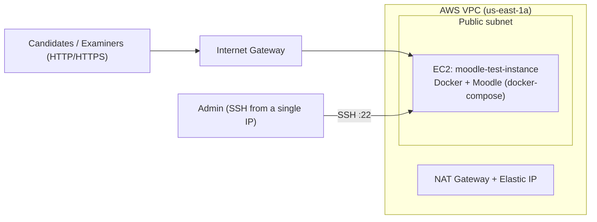

# Moodle LMS for Computer-Based Testing (CBT) on AWS

Terraform code that provisions the AWS infrastructure for a Moodle LMS test environment intended for computer-based testing (CBT): online quizzes and exams delivered through Moodle. Moodle itself runs in containers (Docker Compose) on an EC2 instance, with the network, security groups and bootstrap scripts defined as code.

> **Status:** Test environment / proof of concept. See [Known limitations](#known-limitations--production-roadmap) before running a live exam on it.

---

## Architecture



| Component | File | Purpose |
|---|---|---|
| VPC, subnet, route table | `vpc.tf`, `subnet.tf`, `route-table.tf` | Network foundation |
| Internet gateway | `igw.tf` | Public internet access |
| NAT gateway, Elastic IP | `nat-gw.tf`, `eip.tf` | Outbound routing and static public addressing |
| Security group | `security-group.tf` | Inbound rules for web and SSH |
| EC2 instance | `ec2.tf` | Moodle host (`t3.micro`, 30 GB gp3 root volume, Amazon Linux) |
| Bootstrap | `scripts/docker-setup.sh` | Installs Docker on the instance |
| Moodle stack | `moodle-script/docker-compose.yaml` | Defines the Moodle containers |
| Tags | `local.tf` | Shared `owner` / `environment` tags |

---

## Repository structure

```
.
├── provider.tf
├── vpc.tf
├── subnet.tf
├── igw.tf
├── route-table.tf
├── nat-gw.tf
├── eip.tf
├── security-group.tf
├── ec2.tf                      # Instance + provisioners
├── local.tf                    # Tags
├── scripts/
│   └── docker-setup.sh         # Installs Docker on the instance
└── moodle-script/
    ├── docker-compose.yaml     # Moodle stack definition
    └── .env                    # Runtime config (NOT committed, see Configuration)
```

---

## How it works

1. Terraform builds the VPC, subnet, gateways, routing and security group.
2. It launches the EC2 instance and connects over SSH.
3. Provisioners copy `docker-setup.sh`, `docker-compose.yaml` and `.env` to the instance.
4. `docker-setup.sh` runs with sudo to install Docker.
5. The Moodle stack is then started from `/home/ec2-user/moodle` with Docker Compose.
6. The instance's public IP is printed as the output `moodle-test-instance_public-ip`.

---

## Prerequisites

- AWS account and credentials configured locally
- [Terraform](https://developer.hashicorp.com/terraform/install) 1.x
- An existing EC2 key pair in `us-east-1` and the matching private key file
- Your public IP address (SSH is restricted to it)

---

## Configuration

Before running `terraform apply`, set these values for your environment:

| What | Where | Notes |
|---|---|---|
| Key pair name | `ec2.tf` (`key_name`) | Must exist in `us-east-1` |
| Private key path | `ec2.tf` (`connection.private_key`) | Local path to your `.pem` file |
| Admin SSH IP | `security-group.tf` (`allow_ssh`) | Use your own IP in `/32` form |
| Moodle settings | `moodle-script/.env` | Create it locally; see below |

Create `moodle-script/.env` with the variables your `docker-compose.yaml` expects (database credentials, Moodle admin user, site URL, and so on). **Never commit this file.** Commit a `.env.example` with placeholder values instead.

---

## Usage

```bash
git clone https://github.com/chikechiagbaizu/custom-moodle-lms.git
cd custom-moodle-lms

terraform init
terraform plan
terraform apply
```

When apply finishes, open `http://<moodle-test-instance_public-ip>` (or the port your compose file maps) in a browser and complete the Moodle setup.

Destroy the environment when you're done, especially the NAT gateway, which bills hourly:

```bash
terraform destroy
```

---

## Moodle for CBT: setup checklist

Once Moodle is running, prepare it for exams:

- [ ] Create the course and enrol candidates (manual, CSV upload, or cohort sync)
- [ ] Build question banks with categories, and use random-question quizzes to reduce copying
- [ ] Configure quiz timing, attempts, and shuffled questions and answers
- [ ] Enable a secure browser mode if you need a locked-down exam environment (e.g. Safe Exam Browser)
- [ ] Set up grade review and results release rules
- [ ] **Run a load test with your expected number of concurrent candidates before exam day**
- [ ] Take a database and `moodledata` backup before every live exam

---

## Security controls

| Control | Detail |
|---|---|
| **Restricted SSH** | Port 22 is limited to a single `/32` admin address |
| **Scoped web exposure** | Only web ports (80, 443, plus 8080/8443) accept public traffic |
| **Ignored sensitive files** | `.gitignore` excludes Terraform state and `*.tfvars` |
| **Tagged resources** | `owner` and `environment` tags for cost and ownership tracking |

---

## Known limitations & production roadmap

**Fix before publishing or reusing**

- [ ] **Keep secrets out of Git.** Add `.env` and `*.pem` to `.gitignore`. If `moodle-script/.env` was ever committed, rotate every credential in it and purge it from history (e.g. `git filter-repo`).
- [ ] **Remove hardcoded local values.** The private key path and admin IP are written directly in `ec2.tf` and `security-group.tf`. Move them to variables (`var.private_key`, `var.admin_ip`) and supply them through an untracked `terraform.tfvars`.
- [ ] **Serve over HTTPS only.** Redirect HTTP to HTTPS with a valid certificate (ACM with an ALB, or Let's Encrypt), and close the extra `8080`/`8443` ports if the stack doesn't need them.

**Needed for real exam workloads**

- [ ] **Capacity:** `t3.micro` (1 GB RAM) is a test size. Concurrent quiz attempts need a larger instance type, tuned PHP-FPM and database settings, and load-test evidence.
- [ ] **Database:** move to Amazon RDS with automated backups, instead of a database container on the same host
- [ ] **Persistence and backups:** back up `moodledata` and the database on a schedule (S3 / EBS snapshots) and test restores
- [ ] **High availability:** load balancer plus more than one instance across Availability Zones, shared file storage (EFS), and Redis for sessions and caching
- [ ] **Hardening:** IMDSv2 required, encrypted EBS volumes, restricted egress, SSH replaced by Systems Manager Session Manager
- [ ] **Parameterize** the AMI ID and Availability Zone (currently hardcoded) and pin container image versions
- [ ] **Monitoring:** CloudWatch or Prometheus alerts on CPU, memory and disk during exams
- [ ] **Remote state:** S3 backend with DynamoDB locking

---

## Tech stack

Terraform · AWS (EC2, VPC, NAT Gateway, Elastic IP, Security Groups) · Docker & Docker Compose · Moodle LMS

## Author

**Chike Chiagbaizu**: Odoo Developer & GCP Cloud Architect
[GitHub](https://github.com/chikechiagbaizu) · [LinkedIn](https://www.linkedin.com/in/chike-chiagbaizu-15343aa3/)
